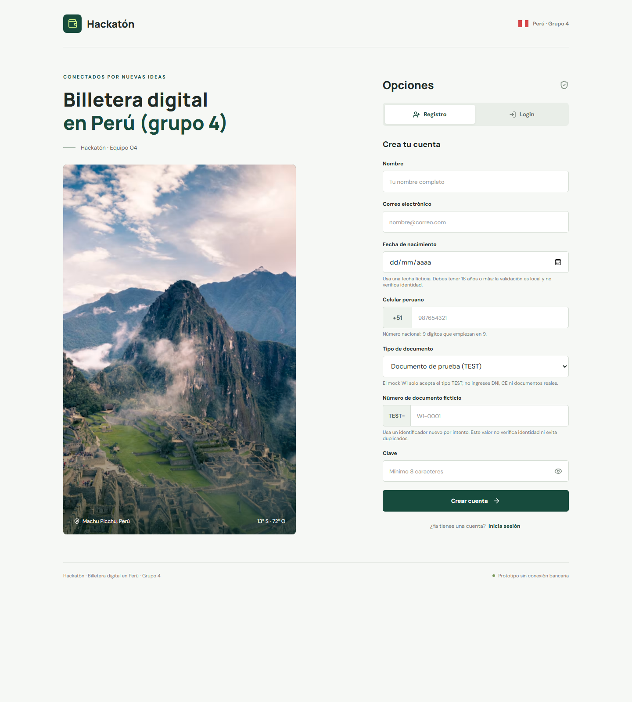
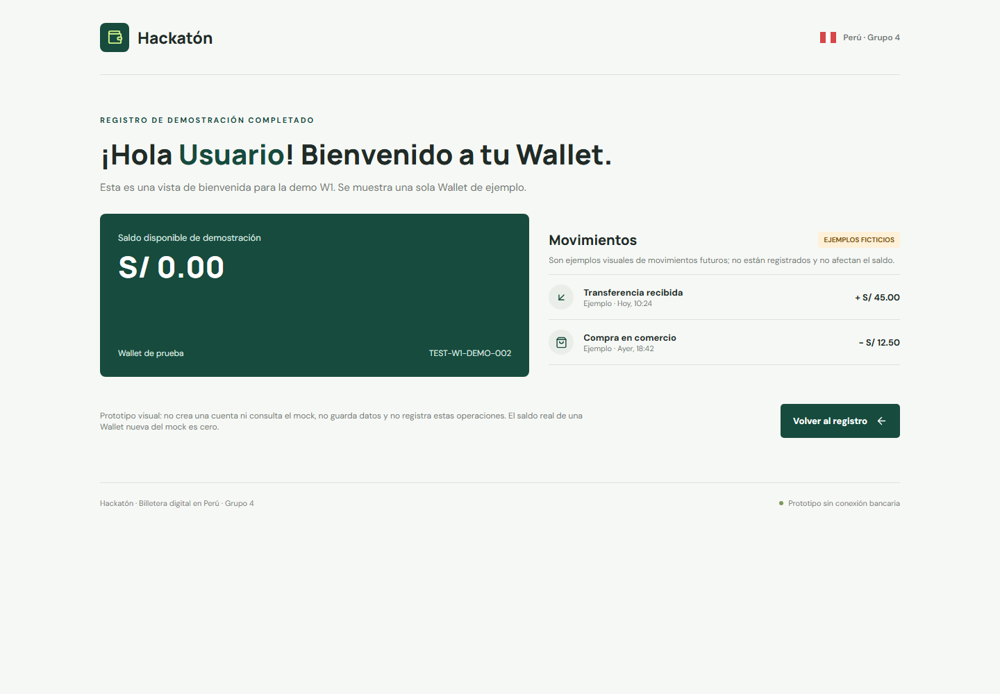

# Wallet para pagos cotidianos

Una propuesta de wallet digital pensada para que las personas puedan empezar con claridad: entender el registro, corregir sus datos y saber cuándo su cuenta está lista para acceder a pagos.

> **Estado de la propuesta:** prototipo de hackatón. Las pantallas son demostrativas; no se crea una cuenta real, no se conecta con bancos y no se procesan pagos.

## La propuesta

El objetivo es reducir la fricción entre el interés por usar una wallet y el primer pago. La experiencia objetivo guía a la persona durante el registro, explica los errores de forma accionable y habilita el acceso a pagos solo cuando la cuenta cumple las condiciones definidas.

La propuesta responde a necesidades concretas:

- Saber qué información se necesita y cómo corregirla.
- Entender el estado de la cuenta y cuál es el siguiente paso.
- Llegar al flujo de pagos con expectativas claras.

## Recorrido propuesto

El flujo funcional descrito en [DiagramaOnBoarding_Pago.md](DiagramaOnBoarding_Pago.md) conecta el registro con un pago QR:

1. La persona inicia el registro y envía sus datos para verificación.
2. Si el resultado KYC es `ACTIVE`, la wallet queda habilitada. Si queda `PENDING`, se crea un caso para revisión; si es `REJECTED`, no se habilita el acceso a pagos.
3. Con la wallet activa, la persona escanea un QR. La aplicación valida que sea válido y esté vigente; si no, informa el error sin crear un pago.
4. Antes de enviar el pago, muestra el comercio y el monto para que la persona confirme o cancele.
5. Al confirmar, se envía el pago con una clave de idempotencia. El resultado puede ser exitoso, rechazado o quedar pendiente; los resultados pendientes o inciertos se consultan sobre el mismo pago.

Este diagrama describe la experiencia objetivo del MVP. El [diagrama de arquitectura](arquitectura-w1-w2.svg) refleja el plan técnico por etapas y marca W2 como futura; no implica que el pago QR esté conectado en la demo actual. La demo visual disponible cubre únicamente pantallas de W1.

## Pantallas del prototipo

La pantalla de registro muestra los campos de demostración y las validaciones locales.



La bienvenida muestra una wallet de ejemplo, saldo cero y movimientos ficticios, identificados expresamente como demostración.



## Arquitectura de referencia

El diagrama presenta la arquitectura de referencia, con W1 como alcance actual y W2 como siguiente etapa técnica. Para el detalle funcional del recorrido completo —incluidos revisión KYC y pago QR— consulta [DiagramaOnBoarding_Pago.md](DiagramaOnBoarding_Pago.md). La pantalla HTML mostrada arriba no está conectada al mock ni a un backend.


## Objetivo del MVP

La meta de producto es reducir la mediana de finalización del onboarding de 8 a 3 minutos. Es un objetivo por validar después de probar la experiencia con usuarios; no es un resultado demostrado por este prototipo.

## Qué demuestra hoy

- Una pantalla adaptable de registro e inicio de sesión.
- Validaciones locales de campos y una vista de bienvenida.
- Una experiencia visual basada en datos sintéticos.

El prototipo no consulta el mock, no persiste datos, no verifica identidades, no genera eventos analíticos y no ejecuta pagos. Los movimientos de la pantalla de bienvenida son ejemplos ficticios y no afectan el saldo.

## Probar la demo

Abre [index_W1.html](index_W1.html) en un navegador. Usa únicamente datos ficticios y un identificador `TEST-`; no ingreses DNI, datos personales reales ni credenciales utilizadas en otros servicios.

## Documentación técnica

Las siguientes secciones describen el backend de referencia y las pruebas del contrato con el mock compartido.

## Backend Quarkus

La [guia del backend](backend/README.md) explica la estructura, generacion de modelos e interfaces desde OpenAPI, ejecucion, pruebas y Docker.

Inicio rapido en PowerShell, con `JAVA_HOME` configurado para Java 21:

```powershell
cd backend
.\mvnw.cmd compile quarkus:dev
```

El endpoint de ejemplo es `http://localhost:8080/health`; Swagger UI esta disponible en desarrollo en `http://localhost:8080/q/swagger-ui`. Las demas operaciones de negocio aun no estan implementadas.

## Contrato y archivos

- [Contrato OpenAPI](client/openapi.json).
- [Coleccion Postman](client/postman/wallet-grupo-4.postman_collection.json): 142 requests para las 32 operaciones del contrato.
- [Entorno Postman del grupo 4](client/postman/wallet-grupo-4.postman_environment.json).

## Ejecutar en Postman

1. Importar la coleccion y el entorno con **Import**.
2. Seleccionar el entorno **Wallet Grupo 4 - Mock**.
3. En Collection Runner, seleccionar las carpetas **01 a 07** y ejecutar una sola iteracion, en orden y sin concurrencia.
4. Revisar las aserciones en **Test Results** o en el resumen del Runner.

Los IDs de KYC, pagos, QR y eventos se capturan automaticamente como variables de coleccion. Una peticion dependiente necesita que se ejecuten sus prerrequisitos; no basta con ejecutar cualquier carpeta de forma aislada. No crear variables de entorno con los mismos nombres que los IDs capturados, porque tendrian prioridad sobre estos.

La carpeta 01 genera un identificador de ejecucion nuevo. Los reintentos intencionales conservan la misma clave de idempotencia y el mismo cuerpo para comprobar que no se duplican pagos.

## Configuracion

| Variable | Valor inicial | Uso |
| --- | --- | --- |
| `baseUrl` | `https://bcp-wallet-mock.yefri.workers.dev/groups/4` | Operaciones del grupo |
| `rootUrl` | `https://bcp-wallet-mock.yefri.workers.dev` | `/groups` y `/usage/all` |
| `latencyMs` | `0` | Cabecera `X-Mock-Latency-Ms` |
| `allowReset` | `NO` | Bloquea el reset por defecto |

La variable de coleccion `walletId` apunta a `wallet-demo`. Todos los importes estan expresados en centimos de PEN: `100` equivale a S/ 1.00.

Consulta de ejemplo:

```sh
curl 'https://bcp-wallet-mock.yefri.workers.dev/groups/4/wallets/wallet-demo' -H 'X-Mock-Latency-Ms: 0'
```

## Escenarios y pruebas

| Carpeta | Cobertura |
| --- | --- |
| 01 - Servicio y preparacion | Salud, escenarios, OpenAPI, grupos y saldo inicial |
| 02 - KYC y onboarding | Aprobacion, rechazo, revision manual, proveedor no disponible, decisiones y wallets sin fondos |
| 03 - Pagos e idempotencia | Aprobacion, rechazo, claves repetidas, conflictos, callbacks duplicados, historial, comprobantes y entradas invalidas |
| 04 - Pendientes timeout y callbacks | Pendientes, aprobacion demorada, timeout tras procesar, reintentos, resolucion y escalamiento |
| 05 - QR comercio | QR fijo, abierto, expirado, invalido y pago con monto incompatible |
| 06 - Conciliacion | Faltantes, montos distintos, duplicados, operaciones huerfanas, restauracion, incidencias y partida doble |
| 07 - Reversos y cierre | Reversos repetibles, confirmacion, restauracion de saldos, soporte, uso y logs |
| 99 - PELIGRO - Reset manual | Reinicio completo del grupo, omitido por defecto |

Las pruebas verifican el codigo HTTP, contenido JSON y esquema de respuesta cuando esta documentado. Tambien comprueban estados, IDs, errores estables, idempotencia, saldo disponible, reservas y diferencias de conciliacion sobre pagos propios.

Se cubren todas las operaciones y diversos escenarios, no todas las combinaciones posibles. No se fuerzan pruebas de carga, agotamiento de cuota (429), cuerpos masivos (413) ni condiciones de carrera.

## Precauciones del mock

- El estado es persistente y compartido por todo el equipo del grupo 4. Coordinar las ejecuciones y evitar cambios concurrentes.
- Usar solo documentos ficticios `TEST-...`, nunca documentos reales ni datos personales.
- Las wallets creadas por KYC tienen saldo cero y el contrato no ofrece recargas. Por eso la suite usa `wallet-demo` y exige al menos `1000` centimos disponibles al inicio.
- La suite completa modifica datos. Al terminar, la carpeta 07 revierte sus cuatro cargos aprobados y comprueba la restauracion del saldo y reservas iniciales. No elimina historial, KYC, QR, eventos ni incidencias.
- Una interrupcion, un error o la actividad concurrente pueden impedir el cierre. Revisar los IDs capturados y completar los reversos propios antes de repetir.
- La conciliacion afecta al grupo completo. Las pruebas verifican diferencias propias sin exigir un resultado global `MATCHED`, ya que puede haber datos previos.
- No incluir la carpeta 99 en el Runner. El reset elimina TODOS los datos del grupo, incluidos los de otros integrantes. Solo tras acuerdo del equipo, establecer `allowReset` en `BORRAR-GRUPO-4`, ejecutar manualmente el reset y devolver el valor a `NO`.
- Usar Postman actualizado: el bloqueo del reset requiere `pm.execution.skipRequest()`.

## Ejecutar con Newman

Requiere Node.js y npm. Ejecutar desde la raiz del repositorio; `npx` descarga Newman si no esta disponible.

Solo consultas, sin modificar datos de negocio:

```sh
npx --yes --package newman newman run client/postman/wallet-grupo-4.postman_collection.json -e client/postman/wallet-grupo-4.postman_environment.json --folder "01 - Servicio y preparacion" --timeout-request 20000
```

Suite completa, con datos de prueba y reversos al cierre. Con el entorno predeterminado, el reset se omite:

```sh
npx --yes --package newman newman run client/postman/wallet-grupo-4.postman_collection.json -e client/postman/wallet-grupo-4.postman_environment.json --timeout-request 20000
```

No usar `--bail` en el recorrido completo: podria detenerlo antes de los reversos. Revisar siempre las pruebas de cierre; continuar la ejecucion no garantiza limpieza ante fallos.

## Validacion realizada

- Cobertura local: 32 operaciones, 142 requests, cuerpos JSON y sintaxis de scripts validos.
- Smoke test real con Newman: 5 consultas y 20 aserciones aprobadas.
- Proteccion del reset comprobada: el request se omite con `allowReset=NO`.
- Los escenarios que modifican datos estan preparados, pero no se han ejecutado contra el grupo compartido. Deben validarse antes de emplearlos como gate de CI.

## Comandos de PR

Ejecutar desde la raiz del proyecto. Cada integrante debe usar un nombre de rama propio y un mensaje que describa sus cambios.

```sh
# Crear una rama propia
git switch -c feat/nombre-del-cambio

# Revisar los archivos antes de agregarlos
git status

# Agregar los cambios y crear el commit
git add .
git commit -m "feat: describir el cambio realizado"

# Subir la rama al remoto
git push -u origin HEAD
```

Antes de ejecutar `git add .`, verificar que no haya credenciales, archivos temporales ni cambios ajenos a la tarea. Para agregar solo archivos concretos, usar `git add ruta/del/archivo`.

Si el commit ya existe localmente y solo falta publicarlo, omitir `git add` y `git commit`. Si todavia no tiene una rama propia, crearla antes del push:

```sh
git switch -c feat/wallet-api-postman
git push -u origin HEAD
```

Si la rama propia ya existe y es la actual, ejecutar solo `git push -u origin HEAD`.

Despues del push, abrir un Pull Request en GitHub desde la rama publicada hacia `main`. Incluir un titulo descriptivo, resumen de cambios, pruebas realizadas y riesgos o validaciones pendientes. No hacer push directo a `main`.
